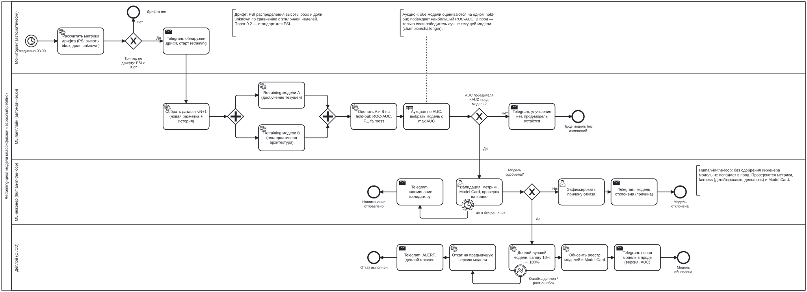
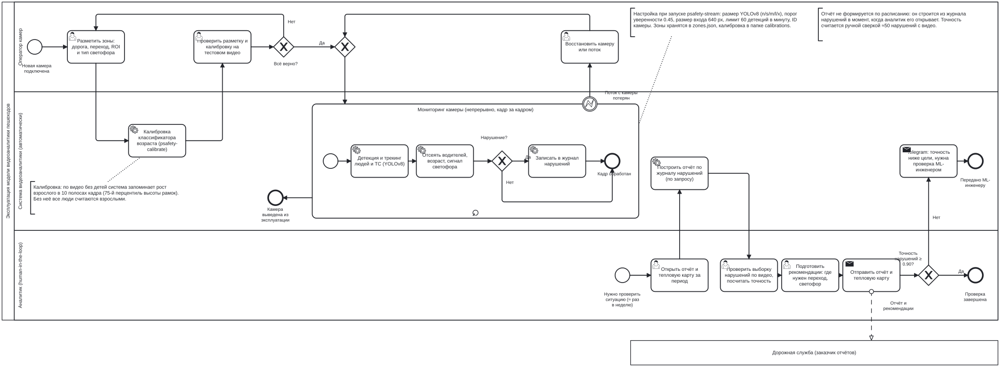

# BPMN: retraining-цикл модели



**Файл схемы:** [`retraining.bpmn`](retraining.bpmn) (BPMN 2.0 XML).
**Как открыть:** зайдите на <https://demo.bpmn.io>, нажмите *Open* и перетащите файл
в окно браузера. Схему можно править и сохранять обратно.

## Что моделирует процесс

Переобучение модели классификации **взрослый / ребёнок** (см. [Model Card](../MODEL_CARD.md)),
когда меняются входные данные: камеру сдвинули, сменился сезон, поменялось освещение.

| Требование задания | Где в схеме |
|---|---|
| Триггер по дрифту | Таймер «Ежедневно 03:00» → «Рассчитать метрики дрифта» → шлюз «Триггер по дрифту: PSI > 0.2?» |
| Retraining | Параллельный шлюз: «Retraining модели A» и «Retraining модели B» обучаются одновременно |
| Валидация (User Task) | «Валидация: метрики, Model Card, проверка на видео» в дорожке *ML-инженер* |
| Сравнение двух моделей (аукцион по AUC) | «Оценить A и B на hold-out» → Business Rule Task «Аукцион по AUC» → шлюз «AUC победителя > AUC прод-модели?» |
| Деплой лучшей | «Деплой лучшей модели: canary 10% → 100%» |
| Уведомление в Telegram | 5 Send Task «Telegram: …» на каждом исходе процесса |

## Дорожки (кто что делает)

1. **Мониторинг (автоматически).** Раз в сутки считает PSI распределения высоты рамок
   и доли `unknown` относительно эталонной недели.
2. **ML-пайплайн (автоматически).** Собирает датасет `vN+1`, параллельно обучает две
   модели-кандидата (A — дообучение текущей, B — альтернативная архитектура),
   оценивает обе на **одном и том же** hold-out и проводит аукцион.
3. **ML-инженер (human-in-the-loop).** Без его одобрения модель не попадает в прод.
4. **Деплой (CI/CD).** Canary-выкатка, обновление реестра моделей и Model Card.

## Логика и исходы

| Исход | Конечное событие | Telegram |
|---|---|---|
| Дрифта нет | «Дрифта нет» | — (тишина в обычный день) |
| Ни A, ни B не лучше прод-модели | «Прод-модель без изменений» | «улучшения нет, прод-модель остаётся» |
| Валидатор отклонил | «Модель отклонена» | «модель отклонена (причина)» |
| Деплой упал или выросли ошибки | «Откат выполнен» | «ALERT, деплой откачен» |
| Успех | «Модель обновлена» | «новая модель в проде (версия, AUC)» |

**Аукцион по AUC.** Победителем среди A и B становится модель с максимальным ROC-AUC
на hold-out. Но выкатывается она только тогда, когда её AUC выше, чем у текущей
прод-модели (схема *champion / challenger*). Поэтому переобучение не может ухудшить прод.

**Human-in-the-loop:**
- Валидация — это **User Task**: её выполняет человек, а не сервис.
- На задаче висит **неблокирующий таймер 48 ч**. Если решения нет, в Telegram уходит
  напоминание, а задача остаётся открытой.
- Отказ обязательно сопровождается **причиной**, она попадает в уведомление и в реестр.
- Валидатор проверяет fairness по срезам (дети / взрослые, день / ночь) из Model Card.
  Модель с лучшим общим AUC, но провалом в срезе, отклоняется.

**Надёжность деплоя.** Граничное событие ошибки на задаче деплоя прерывает её и
запускает откат на предыдущую версию.

## Элементы BPMN, которые использованы

Пул с 4 дорожками, стартовое событие-таймер, Service / Send / User / Business Rule
Task, исключающие шлюзы с условиями на потоках (`${psi > 0.2}`,
`${winnerAuc > prodAuc}`, `${approved == true}`), параллельный шлюз (fork/join),
граничные события: неблокирующий таймер и прерывающая ошибка, текстовые аннотации.

---

# BPMN: бизнес-процесс эксплуатации модели



**Файл схемы:** [`operation.bpmn`](operation.bpmn). Открывается так же, на <https://demo.bpmn.io>.

Если `retraining.bpmn` отвечает на вопрос «как обновлять модель», то эта схема
отвечает на вопрос «как модель работает каждый день»: где она используется, кто
её настраивает и что происходит с её результатами.

## Дорожки

| Дорожка | Кто | Что делает |
|---|---|---|
| Оператор камер | человек | размечает зоны и светофор, проверяет калибровку, восстанавливает камеру при сбое |
| Система видеоаналитики | автоматически | калибровка, непрерывная обработка кадров моделью, еженедельный отчёт |
| Аналитик (human-in-the-loop) | человек | проверяет выборку нарушений по видео, считает точность, готовит рекомендации |
| Дорожная служба | внешний участник (отдельный пул) | получает еженедельный отчёт (поток сообщений) |

## Новые элементы BPMN на этой схеме

| Элемент | Где | Смысл |
|---|---|---|
| **Развёрнутый подпроцесс с циклом** (значок ↻ внизу) | «Мониторинг камеры» | шаги обработки одного кадра повторяются, пока камера в эксплуатации |
| **Прерывающее граничное событие ошибки** | «Поток с камеры потерян» на подпроцессе | мониторинг останавливается, оператор восстанавливает камеру, и процесс возвращается в мониторинг |
| **Неблокирующий граничный таймер** | «Каждый понедельник 09:00» на подпроцессе | раз в неделю запускается ветка отчётности, а мониторинг при этом **не прерывается** |
| **Вызываемая активность** (Call Activity, жирная рамка с ⊞) | «Retraining-цикл модели» | ссылка на второй процесс (`retraining.bpmn`), а не его копия |
| **Второй пул и поток сообщений** (пунктирная стрелка) | «Дорожная служба» | отчёт уходит внешней организации |
| **Шлюз-слияние** | после «Всё верно?» | в мониторинг входят два пути: первый запуск и после восстановления камеры |

## Где модель и как она настраивается

- Модель работает внутри подпроцесса «Мониторинг камеры» (YOLOv8 → возраст и
  светофор → нарушения) и в задаче «Калибровка классификатора возраста».
- Настройки показаны в аннотациях на схеме, полный список — в
  [Model Card, раздел 7](../MODEL_CARD.md).

## Как схемы связаны

```
operation.bpmn  ──(точность < 0.90)──►  retraining.bpmn  ──(новая модель)──►  operation.bpmn
   ежедневная работа                       обновление модели                    снова в работе
```
